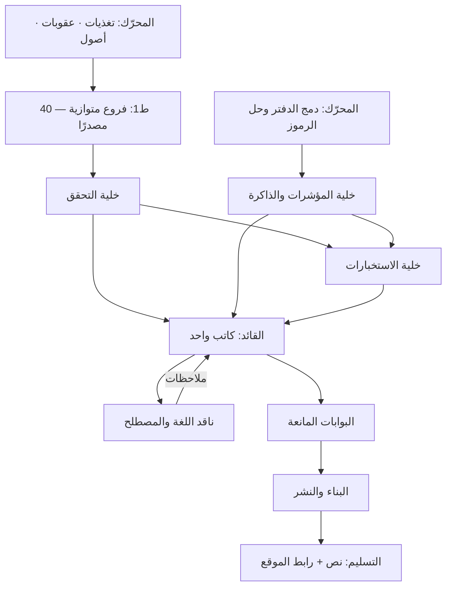
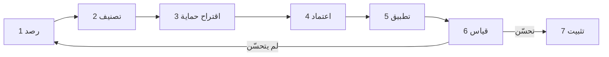

# النمط المقترح: «غرفة العمليات — تحقق متدرّج»

**التاريخ:** 14 أكتوبر 2026 · **النوع:** تصميم نمط خاص بنا (اقتراح لا تنفيذ)
**الغرض:** نمط واحد مبنيّ من أربع عائلات أنماط، مُكيَّف على طريقة عملنا في التقرير الإخباري البحري الصباحي.

## أسماء مرشّحة

| # | الاسم | التقييم |
|---:|---|---|
| 1 | **غرفة العمليات — تحقق متدرّج** | **← الأنسب** |
| 2 | الجسر الواحد — كاتب واحد | جيد، لكنه يبرز جانب الكاتب فقط |
| 3 | الكتيبة المتخصصة — تسليم موحّد | يوحي بأن كل شيء وكيل، وهذا ما لا نريده |

**المختصر في المحادثة:** «غرفة العمليات».

---

## 1) المبدأ الذي يفسّر كل تفصيل بعده

> **الأدوات لا تفكّر، والوكلاء لا يتناقضون، والقائد لا يفوّض صوته — والخطأ لا يُسكَت عنه.**

| العبارة | القرار التصميمي |
|---|---|
| الأدوات لا تفكّر | كل حتمي يبقى **كودًا**: فحص العقوبات · بصمة الأصول · الترقيم · دمج الدفتر · البوابات · البناء · النشر |
| الوكلاء لا يتناقضون | **مالك واحد لكل رقم**، ولا نص نهائي إلا من القائد |
| القائد لا يفوّض صوته | **كاتب واحد** للنص العربي الموجّه للقارئ |
| الخطأ لا يُسكَت عنه | لكل خطوة **سياسة فشل معلنة** + حلقة تعلّم تُغلق الخطأ قبل النوبة التالية |

## 2) الطبقات الخمس

| الطبقة | المحتوى | النمط المستعار | كلفة الحكم |
|---|---|---|---|
| **ط0 — المحرّك** | الخط اليومي · العقوبات · الأصول · الدفتر · الترقيم · البناء · النشر · البوابات | كود حتمي | صفر |
| **ط1 — الجمع** | 38 تغذية + 40 مصدرًا بفروع متوازية | تفريع وتجميع | منخفضة |
| **ط2 — الحكم** | ثلاث خلايا: التحقق · المؤشرات والذاكرة · الاستخبارات | مشرف + منظّم-عمال | متوسطة |
| **ط3 — النقد واللغة** | ناقد مستقل على النص النهائي بمعيار القاموس | منتج-ناقد | منخفضة |
| **ط4 — القيادة** | الكاتب الواحد · حلّ التعارض · منح الرموز · التسليم | مشرف واحد | منخفضة |

### ما نأخذه من كل نمط — وما نتجنّبه

| ما نأخذه | من أي نمط | لماذا |
|---|---|---|
| ترتيب ثابت وبوابات بين الخطوات | خط الأنابيب | التقرير إجراء ثابت كل صباح، لا مهمة مفتوحة |
| جمع متوازٍ من 40 مصدرًا | التفريع والتجميع | الوقت هو القيد والفروع مستقلة |
| قيادة واحدة وتسليم نهائي | المشرف | نقطة مسؤولية واحدة واضحة |
| تحقق مستقل للمصادر والأرقام | التحقق المستقل | لا يُصادق أحد على عمله هو |
| مراجعة اللغة بالقاموس المعتمد | منتج-ناقد | معيار تقييمنا واضح ومكتوب |
| تجمّع مساهمات التحليل في فضاء مشترك | اللوح الأسود (**بنسخة محدودة بدورتين**) | يثري التحليل بلا فوضى |
| منع التسليم عند الفشل | البوابات المانعة | الأمان قبل السلاسة |
| **المتجنَّب** | السرب · النقاش · النظير-لنظير | لا تضمن نتيجة · كلفتها عالية · قنوات لا نحتاجها |

---
## 3) مخطط النمط



**قراءة المخطط:** الحتمي أولًا (المحرّك)، ثم الفروع المتوازية، ثم خلايا الحكم، ثم **كاتب واحد**، ثم **ناقد مستقل**، ثم البوابات القاطعة، ثم النشر.

## 4) عقد التسليم الموحّد (الحزمة)

كل خلية تسلّم **حزمة واحدة بالشكل نفسه**، فلا يحتاج القائد ترجمة بين الوكلاء:

```json
{
  "cell": "verification | metrics | intelligence | language",
  "version": "bundle/1.0",
  "date": "2026-10-14",
  "items": [
    {
      "key": "MN-2026-10-14-01",
      "claim": "بلاغ هجوم على سفينة حاويات — مضيق هرمز",
      "value": {"count": 1, "unit": "بلاغ"},
      "owner": "verification",
      "source": "UKMTO-171",
      "grade": "A2",
      "confidence": "high",
      "evidence": "archive/originals/2026-10-14/ukmto-171.html",
      "verified": {"tier": "V2", "by": "verification", "at": "2026-10-14T03:20Z"}
    }
  ],
  "warnings": ["تعذر الوصول إلى كونا — قراءة عبر مسار بديل"],
  "needs_decision": ["اختلاف مصدرين على موقع الواقعة"]
}
```

**خمس قواعد للعقد:**

1. **لا رقم بلا مالك ومصدر ودرجة** — كل رقم في التقرير موجود في حزمة خلية واحدة فقط.
2. **لا نص موجّه للقارئ** — الحقول وصفية مختصرة، والصياغة النهائية للقائد.
3. **الفشل جزء من الحزمة:** `warnings` إجبارية وتُذكر في التقرير، و`needs_decision` إجبارية وتُرفع للقائد.
4. **درجة الثقة ليست الاحتمال:** الأولى وصف جودة المعلومة، والثانية تقدير حدوث شيء.
5. **قابلية التتبع:** كل بند يحمل `evidence` أو سبب تعذر مكتوب.

---
## 5) التحقق المتدرّج — قلب النمط وكابح الكلفة

لا كل شيء يحتاج ثلاث تحققات؛ الدرجة تُحدَّد بحساسية البند:

| الدرجة | المعنى | من يتحقق | أمثلة عندنا |
|---|---|---|---|
| **V0** | كود حتمي، لا حكم | المحرّك | فحص OFAC · الترقيم · بصمة الأصول |
| **V1** | مراجعة ذاتية داخل الخلية | نفس الخلية | صياغة داخلية · ترتيب بيانات |
| **V2** | تحقق مستقل داخل النظام | خلية أخرى لا تملك البند | الأرقام والفروقات · درجات المصادر · حل الرموز |
| **V3** | تحقق خارجي (خبير/أنت) | بشر | نسبة استهداف إلى جهة · إعلان تهديد · نشر مقيّد |

**القاعدة الاقتصادية:** كل بند **حساس** (يترتب عليه قرار تشغيلي أو يُنسب إلى جهة) يُرقّى إلى V3، وما عداه V1/V2 — فلا ندفع كلفة التحقق الأقصى في كل بند.

## 6) البوابات المانعة (ستّ بوابات)

| # | البوابة | تمنع التسليم إذا | الآلية |
|---:|---|---|---|
| 1 | **البنية** | قسم أو حقل ناقص في ملف الواجهة | `validate_report.py` |
| 2 | **اللغة والمصطلح** | مصطلح غير عسكري أو جملة ثقيلة أو عبارة داخلية | `check_language.py` + القاموس |
| 3 | **التحليل الاستخباري** | تقدير بلا درجة ثقة أو بلا إسناد | `check_intel.py` |
| 4 | **الإسناد والأصول** | بلاغ رسمي بلا أصل محفوظ أو سبب تعذر | `archive/originals/…` |
| 5 | **العقوبات** | سفينة مذكورة بلا نتيجة فحص OFAC | نتائج الفحص في الحزمة |
| 6 | **التصنيف** | إصدار مقيّد يُنشر بلا إظهار التصنيف | حاجز التصنيف في المولّد |

**قاعدة:** بوابة فشلت = تسليم موقوف. لا استثناء «مؤقت» ولا نشر جزئي.

## 7) سياسة الفشل — معلن لا صامت

| نوع الفشل | المثال | السلوك |
|---|---|---|
| **مانع** | بوابة بنية أو لغة أو تحليل فشلت | **يوقف التسليم** ويُصلح قبل النشر |
| **معلن** | مصدر تعذر الوصول · فرع جمع سقط · أداة خارجية توقفت | **يُكمل** ويُذكر حرفيًا في التقرير وقسم المصادر |
| **مكتوم ممنوع** | أداة تفشل بصمت داخل خطوة | يُعدّ **عيبًا** يُعالج بأداة أو بوابة، لا يُترك |

**وهذا الدرس المدفوع الثمن من حادثة 13 أكتوبر ومزامنة النسخة الاحتياطية:** الخطأ الذي لا يُرى أسوأ من الخطأ الذي يُرى.

## 8) توزيع المسؤولية — من يقرر ماذا

| القرار | صاحبه | لا يجوز أن يقرره |
|---|---|---|
| تصنيف واقعة (هجوم مؤكد/تفاعل/غير محسوم) | خلية التحقق | القائد منفردًا |
| رقم المؤشر ونسبته إلى أمس | خلية المؤشرات | خلية الاستخبارات |
| درجة الثقة والاحتمال | خلية الاستخبارات | خلية التحقق |
| منح رمز الحدث | المحرّك + القائد | أي خلية منفردة |
| حسم تعارض خليتين | القائد بقاعدة معلنة | الخليتان بالتفاوض |
| الصياغة النهائية | القائد وحده | كل الخلايا |
| النشر أو منعه | البوابات (آلية) | القائد بلا بوابة |

---
## 9) دورة النوبة اليومية (زمنيًا)

التسليم 07:00 بتوقيت البحرين (04:00 UTC)؛ والعمل يبدأ قبله بنافذة محددة:

| الترتيب | المرحلة | الطبقة | توازٍ |
|---|---|---|---|
| 1 | فحص ما قبل التشغيل + ضمان الخدمات | ط0 | تسلسلي |
| 2 | الخط اليومي: تغذيات · عقوبات · أصول | ط0 | تسلسلي |
| 3 | مسح المصادر الأربعين | ط1 | **متوازٍ** |
| 4 | خلية التحقق (تصنيف · درجات · أصول) | ط2 | مع 5 و6 |
| 5 | خلية المؤشرات (فروقات · رموز · دفتر) | ط2 | مع 4 و6 |
| 6 | خلية الاستخبارات (ACH · ثقة · افتراضات) | ط2 | بعد 4 و5 |
| 7 | كتابة النص النهائي | ط4 | تسلسلي |
| 8 | نقد اللغة والمصطلح | ط3 | تسلسلي |
| 9 | البوابات الستّ | ط0 | تسلسلي |
| 10 | البناء · الفحص الآلي · النشر | ط0 | تسلسلي |
| 11 | التسليم + تسجيل الدروس | ط4 | تسلسلي |

**نقطتا إشراف بشري اختياريتان:** قبل اعتماد أي نسبة إلى جهة (V3)، وقبل نشر إصدار مقيّد.

## 10) حلقة التعلّم الذاتي (إلزامية في النمط)

النمط لا يُعدّ مطبَّقًا إن لم تكن هذه الحلقة فعّالة: كل خطأ يُغلق ويُحوّل إلى حماية.



| الخطوة | التفصيل | الملف المسؤول |
|---|---|---|
| 1 · رصد | كل فشل بوابة · كل ملاحظة منك · كل تصحيح ميداني | `memory/learning-log.jsonl` |
| 2 · تصنيف | لغة · رقم · مصدر · بنية · أداة · تحليل · تصميم | الحقل `category` |
| 3 · اقتراح حماية | **قاعدة ثلاث ضربات:** الخطأ الثالث يتحوّل من «تنبيه نصي» إلى **بوابة أو أداة آلية** | `sections/80-learning.md` |
| 4 · اعتماد | **لا تُعدَّل مهارة ولا قاعدة معتمدة إلا بموافقتك الصريحة** | بوابة اعتماد التغيير |
| 5 · تطبيق | تعديل القاعدة أو الأداة أو القاموس | `sections/*` · `validators/*` · `tools/*` |
| 6 · قياس | ثلاثة إصدارات: هل تكرر الخطأ؟ | سجل التعلم + سجل دقة التقديرات |
| 7 · تثبيت أو تراجع | إن لم يتحسّن → تراجع ومسار بديل | `appendices/estimate-accuracy-log.md` |

**ثلاث ضمانات ضد الانحراف:**
1. **لا تعلّم صامت:** كل تغيير يُسجَّل مع تاريخه وسببه ومصدره.
2. **لا ترقية بلا دليل:** لا تُرقّى قاعدة أو درجة مصداقية بلا دليل مكتوب.
3. **لا تطبيق على المهارات بلا موافقتك:** اقتراح يُعرض عليك، وتطبيق بعد اعتمادك.

---
## 11) مقاييس الحكم على النمط (ثلاثة إصدارات متتالية)

| المقياس | الهدف | من يقيس |
|---|---|---|
| تناقض رقمي بين قسمين | **صفر** | خلية المؤشرات |
| ترقية مصداقية بلا تأكيد مستقل | **صفر** | خلية التحقق |
| ملاحظة لغوية أو مصطلح غير عسكري | **صفر** في المراجعة الأسبوعية | ناقد اللغة |
| بلاغ رسمي بلا أصل محفوظ أو سبب تعذر | **صفر** | بوابة الإسناد |
| رمز حدث غير محلول في خريطة الرموز | **صفر** | بوابة البنية |
| زمن التسليم | لا يزيد عن الوضع الحالي بأكثر من **50%** | المحرّك |
| كلفة التشغيل | داخل السقف الذي تحدده أنت | القائد |

**قاعدة القرار:** إن تحقّقت المقاييس نُثبّت النمط؛ وإن لم تتحقق، نعيد الضبط أو نتراجع خطوة — **لا تتبنّى بالإعجاب بل بالقياس.**

## 12) كيف يُطبَّق على نظامنا الحالي (بدون هدم)

| العنصر | مصيره |
|---|---|
| `tools/` (الخط اليومي · العقوبات · الأصول · الدفتر · الترقيم · النشر) | **يبقى كودًا كما هو** — ط0 |
| `validators/` (البنية · اللغة · الاستخبارات) | **يبقى كودًا** ويُربط بالبوابات — ط0 |
| مسح المصادر الأربعين | **يبقى كما هو** — ط1 |
| التحليل الاستخباري | **يتحول إلى خلية مستقلة** بحزمة بيانات — ط2 |
| الأرقام والفروقات والرموز | **تصبح خلية مؤشرات مالكة للأرقام** — ط2 |
| المصادر والدرجات | **تصبح خلية تحقق مستقلة** — ط2 |
| اللغة والمصطلح | **يصبح ناقدًا مستقلًا** على النص النهائي — ط3 |
| كتابة النص والتسليم | **يبقى بيد القائد** — ط4 |
| `sections/` و`memory/` | تُضاف لها عقود الخلايا وحلقة التعلّم |

## 13) خطة التطبيق على أربع مراحل (تحتاج موافقتك)

| المرحلة | المحتوى | بوابتها |
|---|---|---|
| **1** | تثبيت عقد الحزمة + تحويل «المؤشرات والذاكرة» إلى خلية مالكة للأرقام | صفر تناقض رقمي في ثلاثة إصدارات |
| **2** | تحويل «التحقق من المصادر والدرجات» إلى خلية مستقلة | صفر ترقية بلا تأكيد مستقل |
| **3** | تحويل «التحليل الاستخباري» إلى خلية + ناقد لغة مستقل | صفر ملاحظة لغوية + اكتمال درجات الثقة |
| **4** | تشغيل النوبة كاملة بخط زمني واحد ولوحة قياس | تسليم آلي ثلاث مرات متتالية بلا تدخل |

**ملاحظة إلزامية:** أي تعديل على المهارتين المعتمدتين (`marine-news-brain` و`military-arabic-editing`) أو على القواعد المعتمدة **لا يُطبَّق إلا بموافقتك الصريحة**، ويُسجَّل في سجل التعلم بتاريخه وسببه.

## 14) مصادر التصنيف

- أنماط سير العمل والوكلاء — Anthropic: https://www.anthropic.com/engineering/building-effective-agents
- مقارنة معماريات الأنظمة متعددة الوكلاء (مشرف · هرمي · نظير-لنظير · لوح أسود · سرب): https://www.openlayer.com/blog/multi-agent-system-architecture-guide
- اختيار نمط التصميم الوكيلي — Google Cloud: https://docs.cloud.google.com/architecture/choose-design-pattern-agentic-ai-system
- أنماط التنسيق الخمسة في الإنتاج 2026 (تفريع · خط أنابيب · نقاش · مشرف · سرب): https://www.digitalapplied.com/blog/multi-agent-orchestration-5-patterns-that-work
- بروتوكول A2A لتواصل الوكلاء (المرجع المستقبلي إن احتجنا أطرًا متعددة): https://github.com/a2aproject/a2a

---

## الخلاصة في سطرين

**النمط:** محرّك حتمي + فروع جمع متوازية + ثلاث خلايا حكم + ناقد لغة مستقل + **كاتب واحد** + ستة بوابات مانعة + حلقة تعلّم تُغلق كل خطأ.
**الوعد:** صفر تناقض في الأرقام · صفر ترقية بلا دليل · صفر مصطلح غير عسكري يصل إليك — وبتكلفة أقل من الهرمي الكامل، لأن التحقق متدرّج لا موحّد.
---

## 15) مقارنة الكلفة — الوضع الحالي مقابل النمط

### خط الأساس الفعلي (تشغيل 14 أكتوبر 2026)

| العنصر | القيمة | من يدفع الكلفة |
|---|---|---|
| تغذيات مفحوصة | **30 قناة · 209 كيلوبايت** JSON | الكود (مجاني) + قراءة الوكيل (مكلفة) |
| أصول رسمية محفوظة | 3 | الكود (مجاني) |
| صفحات جُلبت بحكم الوكيل | 6 | الوكيل (مكلفة) |
| التقرير النصي | 271 سطرًا · 33 كيلوبايت | الوكيل (كتابة) |
| ملف الواجهة | 26 كيلوبايت | الوكيل (كتابة) |
| بوابات ومدققات | 6 بوابات | الكود (مجاني) |

**الاستنتاج البنيوي:** الكلفة عندنا لا تأتي من عدد الأدوات — فكل أدواتنا كود مجاني — بل من **حجم ما يقرأه ويكتبه الوكيل في سياق واحد كبير**: نحو 210 كيلوبايت قراءة و60 كيلوبايت كتابة يوميًا.

### السيناريوهات الثلاثة

| السيناريو | وحدات عمل الحكم | الكلفة النسبية | الجودة |
|---|---|---|---|
| **1. الوضع الحالي** | وكيل واحد بسياق كبير + 6 عمليات جلب | **100%** (خط الأساس) | جيدة، والأخطاء معالجة بالبوابات |
| **2. النمط كاملًا بلا توسيع ط0** | الخط الحالي + 3 خلايا حكم + ناقد لغة (بسياقات صغيرة) | **≈ 120–125%** | أعلى: صفر تناقض رقمي ودرجات مصداقية محكومة |
| **3. النمط مع توسيع ط0 (الترشيح بالكود)** | الكود يرشّح 210 كيلوبايت إلى ≈10 كيلوبايت بنود · الخلايا تعمل على حزم صغيرة · القائد يقرأ ≈10 كيلوبايت ويكتب النص | **≈ 50–70%** | نفس جودة السيناريو 2 أو أعلى |

**لماذا السيناريو 3 أرخص؟** لأن أغلى عنصر عندنا (قراءة 210 كيلوبايت من التغذيات في سياق الوكيل) ينتقل إلى الكود، ولا يصل للوكلاء إلا **البنود ذات الصلة**، فتصبح كل خلية صغيرة السياق — والسياق هو المحرّك الأول للكلفة.

### القاعدة الاقتصادية

> **الترشيح بالكود قبل التفكير بالوكيل.** كل كيلوبايت يُستبعد بالكود هو كيلوبايت لا يُدفع ثمنه في كل تشغيل.

### خطة الكلفة الدنيا (توصية)

1. **الآن ودون أي وكيل إضافي:** توسيع ط0 ليرشّح التغذيات ويجهّز حزمة البنود ذات الصلة — **الكلفة تنخفض** فورًا.
2. **ثم خلية واحدة** (المؤشرات والذاكرة) لأنها مصدر أكبر خطأ مسجّل.
3. **ثم خلية التحقق** إن بقي تكرار في الدرجات.
4. **ثم ناقد اللغة** إن بقيت ملاحظات لغوية.

بهذا لا ندفع كلفة النمط كاملة، ونكسب مكاسبه تدريجيًا، مع قياس قبل/بعد لكل خطوة.

### قياس فعلي قبل أي قرار

لا يوجد تقدير نظري موثوق لكلفة كل تشغيل؛ الحل: **عدّاد كلفة** داخل الخط اليومي يسجّل لكل تشغيل: عدد نداءات الوكلاء · حجم السياق المقروء والمكتوب · زمن كل مرحلة. فيصبح لدينا خط أساس رقمي، ونقارن بعده أي تغيير بلا تخمين.
