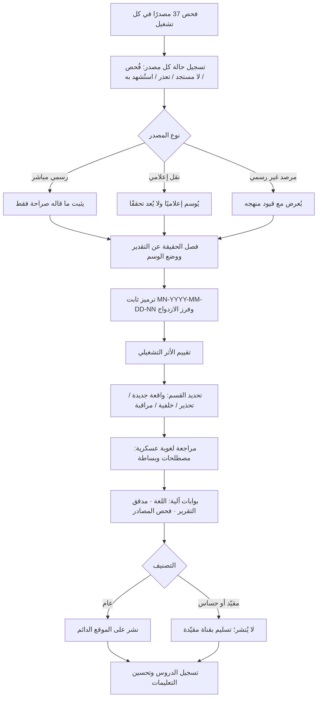

# دليل التقرير اليومي — نوع المعلومات، التغطية، الإجراءات، والاستخدام

**الغرض:** مرجع مختصر يوضح ما يقدّمه التقرير اليومي بالضبط: نوع معلوماته، فترته، مجال تغطيته، ما يشمله، الإجراءات عند الحصول على المعلومة، وكيف تُصفّى وتُستخدم.
**آخر تحديث:** 12 أكتوبر 2026 · **المصادر المرجعية:** `sections/10-sources.md` · `sections/30-structure.md` · `sections/40-blocks.md` · `sections/50-analysis.md` · `appendices/terminology.md`

---

## بطاقة سريعة

| البند | القيمة |
|---|---|
| الاسم | التقرير اليومي لأمن الملاحة (مركز الوعي بالمجال البحري) |
| وقت التسليم | **07:00 صباحًا بتوقيت البحرين** (04:00 UTC)، آليًّا كل يوم |
| نافذة التغطية | **آخر 24 ساعة وفق UTC**، مع نقل التطورات الأقدم التي ما زال أثرها مؤثرًا إلى «الخلفية القائمة» |
| النطاق الجغرافي | الخليج العربي · مضيق هرمز · خليج عُمان · بحر العرب · البحر الأحمر/باب المندب وخليج عدن عند الصلة المباشرة · **المحيط الهندي** · **القرن الأفريقي** |
| المصادر | **37 مصدرًا معتمدًا** تُفحص في كل تشغيل، ويُسجَّل لكل مصدر: فُحص / لا مستجد / تعذر الوصول / استُشهد به |
| قناة التسليم | صفحة ويب على الموقع الدائم + ملخص في المحادثة · و**PDF عند الطلب فقط** |
| التصنيف | `عام` أو `مقيّد` أو `حساس` — والثلاثة **تُنشر** على الرابط الخاص بصاحب القرار، مع إظهار درجة التصنيف في الترويسة |
| الأقسام | 13 قسمًا + بطاقة قرار + شريط مؤشرات + خريطة + جداول تحليلية |

---

## 1) نوع المعلومات التي يجلبها التقرير

التقرير **ليس ملخص أخبار**، بل **منتج استخباراتي تشغيلي** يعرض سبعة أنواع من المعلومة مفصولة عن بعضها فصلًا صريحًا:

| النوع | ما يعنيه | أين يظهر |
|---|---|---|
| وقائع مؤكدة | إصابة أو ضرر أو حادث ثبت بمصدر رسمي مباشر | الوقائع الجديدة (وسم «واقعة مؤكدة») |
| إرشادات رسمية | تحذيرات أمنية بحرية ونشرات استشارية للجهات الرسمية | التحذيرات والنشرات الرسمية |
| إحصاءات رسمية | حصيلة IMO التراكمية (حوادث مؤكدة، وفيات) ومؤشرات UKMTO | سجل IMO · جدول المؤشرات |
| صورة الحركة الملاحية | العبور والرسو والتكدس من مصادر رصد معلنة | الحركة الملاحية والتكدس |
| تقدير تحليلي | مستوى التهديد ودرجة الثقة وحدود التقدير | مستوى التهديد (وسم «تقدير تحليلي») |
| احتمالات وإسناد | من قد يكون مسؤولًا، بلا نسبة قاطعة | الاحتمالات والإسناد |
| مجهولات وتكليفات | ما لم يُحسم ومن يملك حسمه | ما لم يُحسم · تكليفات المتابعة |

**وسوم الصياغة المعتمدة:** `[حقيقة]` · `[تقدير]` · `[إعلامي]` · `[خلفية]` · `[مراقبة]` · `[ثقة: عالية/متوسطة/منخفضة]`.
**قاعدة حاكمة:** كل بند تحليلي يحمل وسمًا واحدًا على الأقل؛ وسم بلا مصدر يعني خلط الحقيقة بالتقدير.

---

## 2) الفترة التي يغطيها

- **النافذة الأساسية:** آخر **24 ساعة** حتى لحظة القطع (وقت الفحص)، محسوبة بـ**UTC** لا بالتوقيت المحلي.
- **التسليم:** 07:00 بتوقيت البحرين (UTC+3) أي 04:00 UTC، فالنافذة الفعلية تبدأ من لحظة القطع السابقة.
- **قاعدة الأثر الأقدم:** أي تطور أقدم ما زال **مؤثرًا على التشغيل** لا يُسقَط؛ يُنقل إلى **الخلفية القائمة** بسطر واحد بدل إعادة احتسابه كواقعة جديدة.
- **المقارنة:** كل رقم يُقارَن بـ**تقرير أمس** صراحةً، ولا تقف المقارنة عند الأمس: تُراجَع نافذتا **48 و72 ساعة** الماضيتان، ويُربط الحدث الجديد بأي **حدث سابق له ارتباط مباشر** يؤثر في مجريات الأحداث مع ذكر **الرمز الثابت** للحدث السابق في المتن.
- **الاستدلال المستقبلي (مؤجّل):** توقّع مسار الأحداث بعد 24 و48 و72 ساعة قادمة **غير مُفعَّل**، ويبقى بندًا مؤجلًا حتى اعتماد قواعده.
- **النافذة الزمنية في الحركة الملاحية:** تُعرض كل أيام النافذة (سبعة أيام) حتى الأيام بلا سجلات، فلا يُوهم القارئ باستمرارية غير موجودة.

---

## 3) مجال تغطية المعلومات

**جغرافيًا:** المياه التي تمسّ الملاحة في نطاق المسؤولية — الخليج العربي، مضيق هرمز، خليج عُمان، بحر العرب، والبحر الأحمر/باب المندب وخليج عدن عند وجود صلة مباشرة، و**المحيط الهندي**، و**القرن الأفريقي**. ولا يُجمع نشاط منطقتين مختلفتين في رقم واحد.

**موضوعيًا:** كل ما يؤثر على **السفينة والعبور والرسو والطاقم والاتصال والملاحة**:

- **القرصنة · الاستهداف · السطو المسلح · الهجمات**، وكل ما له تأثير **مباشر أو غير مباشر** على الإبحار الآمن.
- استهداف السفن التجارية أو الناقلات (مقذوفات، مسيّرات، صعود، احتجاز).
- التحذيرات والنشرات الرسمية ومسارات الإبلاغ (UKMTO · JMIC · NAVAREA · IMO-MSI).
- الحصيلة الرسمية التراكمية وأثرها على قراءة الموقف.
- الحركة الملاحية والتكدس وزمن الانتظار وإيقاف البث (AIS).
- الإجراءات الوقائية: نقاط التجمع، الإخلاء، القطر، مكافحة الحريق، تقييم التلوث.
- التهديد المركّب على الطاقم والبيئة البحرية.

**غير مشمول:** المياه والأحداث التي لا صلة لها بأمن الملاحة في النطاق، والنشاط البرّي أو السياسي بلا أثر بحري مباشر.

---

## 4) ما يشمله التقرير (المحتوى الفعلي)

| # | القسم | ما يقدّمه |
|---:|---|---|
| — | **عام** (بطاقة القرار) | ما تغيّر · مستوى الخطر · التوصيات · ما يُراقب خلال 24 ساعة |
| — | شريط المؤشرات العلوية | أرقام مفتاحية سريعة مع اتجاه كل رقم |
| 1 | ما تغيّر منذ التقرير السابق | جديد · تغيّر تصنيف · أُغلق · متابعة، بالرمز الثابت |
| 2 | الخلاصة | الموقف ومستوى الخطر والإجراء المقترح في ثلاثة أسطر |
| 3 | التوزيع الجغرافي للوقائع | أين تركّزت الوقائع + خريطة الوقائع + حصيلة IMO حسب المنطقة |
| 4 | مؤشرات الموقف | جدول: المؤشر · اليوم · الأمس · الاتجاه · حدود الرقم |
| 5 | مستوى التهديد | التقييم الرسمي والتقدير التحليلي ودرجة الثقة والمناطق الأخرى |
| 6 | التوجيهات التشغيلية | إجراءات قابلة للتنفيذ: العبور · المراسي · الملاحة · الطاقم · القرار الملاحي |
| 7 | الوقائع الجديدة | بطاقات الوقائع المؤكدة + بند النقل الإعلامي مفصولًا + جدول تتبع الوقائع |
| 8 | التحذيرات والنشرات الرسمية | حالة كل جهة رسمية خلال النافذة |
| 9 | سجل IMO | الحصيلة التراكمية وآخر إدخال ظاهر وما لا تشمله |
| 10 | الاحتمالات والإسناد | جدول ترجيح الاحتمالات + اختبار الفرضية المضادة |
| 11 | الحركة الملاحية والتكدس | قراءات المضيق والرسو وخط زمني للنافذة |
| 12 | ما لم يُحسم | الفجوات + جدول تكليفات المتابعة (الفجوة · الجهة القادرة على الحسم · الأثر) |
| 13 | الخلفية القائمة | وقائع أقدم ما زال أثرها مؤثرًا |
| 14 | المصادر والمراجع | حالة الـ37 مصدرًا + روابط المراجع المستشهد بها |

**قواعد العرض:** كل عنوان يتبعه سطر وصفي واحد · كل حدث يحمل رمزًا ثابتًا `MN-YYYY-MM-DD-NN` لا يتغير بين التقارير (تتغير حالته فقط: نشط/مستقر/مغلق) · الوسوم الظاهرة للقارئ · بلا أي مصطلح بناء داخلي.

---

## 5) الإجراءات عند الحصول على المعلومة (خط الإنتاج)

**الخطوات بالتفصيل:**

1. **الجمع:** فحص المصادر السبعة والثلاثين (طلب مباشر، أو متصفح عند الحجب، أو مسار بديل إلزامي) — ولا يُكتب «تعذر الوصول» قبل تجربة المسار البديل.
2. **التسجيل:** حالة كل مصدر على حدة، والتفريق بين **المفحوص** و**المستشهد به**.
3. **التصنيف المصدري:** رسمي مباشر (يثبت ما قاله صراحة) · نقل إعلامي (يُوسم ولا يُعد تحققًا) · مرصد غير رسمي (يُعرض مع قيوده).
4. **التحقق:** مقابلة النقل الإعلامي بالمصدر الرسمي، ولا يُرفع البيان الواحد إلى تحقق مستقل لأن جهتين نقلتاه.
5. **الوسم:** حقيقة / تقدير / إعلامي / خلفية / مراقبة + درجة ثقة (عالية · متوسطة · منخفضة فقط).
6. **الترميز والتتبع:** رمز ثابت لكل واقعة، وتغيير الحالة لا الرمز، ومنع احتساب البلاغ الأولي وتحديثه واقعتين.
7. **تقييم الأثر:** ماذا يعني ذلك للسفينة والعبور والرسو والطاقم الآن.
8. **المراجعة اللغوية العسكرية:** بساطة اللغة، دقة المصطلح، وحذف أي عبارة داخلية.
9. **البوابات الآلية:** بوابة اللغة (طول الجمل والعبارات الثقيلة) · مدقق بنية التقرير · فاحص المصادر — وأي فشل يوقف التسليم حتى التصحيح.
10. **التصنيف والبوابة:** الإصدار المقيّد أو الحساس يُستبعد من الموقع العام، ويوقف البناء إن كان كل الإصدارات مقيّدة.
11. **التسليم:** صفحة الويب + الملخص في المحادثة، وPDF عند الطلب فقط.
12. **التعلّم:** كل خطأ متكرر أو تصحيح يُسجَّل في سجل التعلّم ويُقرأ في التشغيل التالي لمنع تكراره.

---

## 6) كيف تُصفّى المعلومات وتُستخدم

### أ) قواعد التصفية (الفلترة)

| القاعدة | الأثر |
|---|---|
| البلاغ لا يصبح هجومًا | يُكتب «وقائع جديدة» ما لم تثبت طبيعة الواقعة |
| المصدر الإعلامي ليس تحققًا | يُوسم إعلاميًا ويبقى منفصلًا عن المؤكد |
| لا إسناد بلا مصدر رسمي مباشر | لا تُنسب جهة منفذة، ويبقى الاحتمال احتمالًا |
| لا تُجمع أرقام مختلفة التعريف | سجلات UKMTO ≠ حصيلة IMO ≠ عدد الهجمات ≠ أرقام الرصد |
| كل رقم بثلاثة | من أين جاء · يُقارن بماذا · وما لا يشمله |
| درجة الثقة ثلاث قيم فقط | عالية · متوسطة · منخفضة، بلا نسب مئوية |
| الفجوة بلا مالك لا تُدرج | كل مجهول يُقترن بجهة قادرة على حسمه |
| القسم بلا بيانات يُحذف | لا كتلة تُملأ بالتقدير، ولا حشو |
| النقل بلغة محايدة | «أفادت» للنقل الإعلامي · «أعلنت/أكدت» للجهة المصدرة |
| لا تكرار للمعلومة نفسها | البند القديم مكانه الخلفية أو المراقبة، لا الوقائع الجديدة |

### ب) كيف تُستخدم

1. **قرار تشغيلي فوري:** تعديل مسار العبور، تأجيل أو تقصير الرسو، رفع المراقبة على الممر، تنفيذ استعداد الإخلاء والقطر.
2. **إحاطة القيادة:** الخلاصة الثلاثية (الموقف · مستوى الخطر · الإجراء) وبطاقة القرار تكفي لقراءة دقيقة واحدة.
3. **التنبيه المبكر:** حدث عالي الخطورة يُبلَّغ به **فورًا** عبر مراقب شرطي على المصادر، لا ينتظر تقرير الصباح.
4. **ذاكرة تراكمية:** كل واقعة تدخل دفتر الأحداث، ويُبنى منها **السجل التراكمي** و**اللوحة الشهرية** و**الإصدار الشهري التحليلي**.
5. **الاستدلال الزمني:** المقارنة بيوم أمس والأسبوع والشهر تكشف الاتجاه لا الخبر المفرد.
6. **التحسين الذاتي:** سجل التعلّم يمنع تكرار الخطأ اللغوي أو التصنيفي في التقارير التالية.

---

## 7) حدود التقرير (ما لا يقدّمه)

- **لا يثبت الإسناد:** لا يسمّي جهة منفذة بلا مصدر رسمي مباشر.
- **لا يتحقق من الإعلام:** النقل الإعلامي يبقى نقلًا مُوسمًا.
- **لا يستنتج عدد هجمات** من حصيلة IMO أو من عدد البلاغات.
- **لا يحوّل تصنيف التأمين إلى إغلاق قانوني** للمضيق.
- **لا يعرض بيانات AIS خام**، بل قراءات مصادر الرصد المعلنة مع قيودها.
- **لا ينشر المحتوى المقيّد أو الحساس** على الرابط العام.
- **لا يملأ الفراغ بتخمين:** المجهول يُعلن مجهولًا ويُدرج في تكليفات المتابعة.
---

## 8) ملحق التعديلات المعتمدة — 12 أكتوبر 2026 (الدفعة الثانية)

| # | التعديل | الحالة |
|---:|---|---|
| 1 | النطاق الجغرافي: إضافة **المحيط الهندي** و**القرن الأفريقي** | ✔ مُطبَّق |
| 2 | النطاق الموضوعي: إضافة **القرصنة · الاستهداف · السطو المسلح · الهجمات** وكل ما له تأثير مباشر أو غير مباشر على الإبحار الآمن | ✔ مُطبَّق |
| 3 | عدم الاقتصار على مقارنة الأمس: مراجعة **48 و72 ساعة** الماضيتين وربط الحدث الجديد بأي حدث سابق له ارتباط مباشر بذكر **رمزه الثابت** | ✔ مُطبَّق |
| 4 | **التحقيق متعدد المصادر:** معلومة من مصدر واحد ⇒ بحث عن الموضوع نفسه في **الـ37 مصدرًا** لاستكمال الأجزاء وكشف التعارض | ✔ مُطبَّق |
| 5 | الاستدلال الزمني الماضي موسّع إلى **48 و72 ساعة** | ✔ مُطبَّق |
| 6 | الاستدلال الزمني **المستقبلي** (+24 · +48 · +72 ساعة بعد الإصدار) | ⏳ **مؤجّل** بقرار صاحب القرار — لا يُنفَّذ حتى اعتماد قواعده |
| 7 | استثناء **الإعلام المعتمد** من قاعدة «النقل الإعلامي ليس تحققًا» | ⏳ بانتظار اختيار الجهات من `docs/قائمة-الجهات-الإعلامية-للاعتماد.md` |
| 8 | نشر المحتوى **المقيّد والحساس** على الرابط الخاص | ✔ مُطبَّق · **تنبيه:** الرابط غير محمي بكلمة مرور، وأي حماية تُضاف لاحقًا عند الطلب |

**خطوة الإجراءات (4) بصيغتها الملزمة:** عند ورود معلومة من أي مصدر، يُتبَّع الموضوع نفسه في جميع المصادر السبعة والثلاثين. مصدر يذكر جزءًا وآخر يذكر جزءًا آخر، والاكتمال يأتي من الجمع — ويُكتب في المتن ما أضافه كل مصدر، ويُعلن التعارض إن وُجد.

**قاعدة الاستدلال الزمني المعتمدة:** المقارنة على **24 ساعة · 48 ساعة · 72 ساعة · الأسبوع · الشهر**، مع ربط الأحداث المترابطة بالرمز الثابت. والغرض كشف **الاتجاه** لا سرد الخبر المفرد. ولا يُكتب أي توقع مستقبلي حتى يُعتمد بند المستقبل بقواعده.
