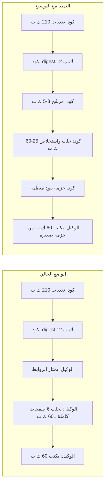

# شرح تفصيلي: خطة الكلفة الدنيا — والفرق بين الوضع الحالي والنمط الموسَّع

**التاريخ:** 15 أكتوبر 2026 · **النوع:** شرح تصميمي (لا تنفيذ)
**ملاحظة منهجية:** كل رقم في هذا المستند **مقيس فعليًا** من تشغيل 14 أكتوبر 2026 في `/home/ubuntu/brain-marine-news`، لا مقدَّرًا.

---

## الجزء الأول: الوضع الحالي بالتفصيل — من يقرأ ماذا؟

### 1.1 خط الأنابيب كما يعمل الآن

| # | الخطوة | المنفّذ | ما ينتج |
|---:|---|---|---|
| 1 | فحص ما قبل التشغيل | كود `preflight_check.py` | تقرير جاهزية (نجح/تحذير/فشل) |
| 2 | سحب التغذيات | كود `check_feeds.py` | **JSON خام 209.7 ك.ب** + **ملخص digest 11.9 ك.ب** |
| 3 | فحص العقوبات | كود `ofac_screen.py` | نتائج لكل سفينة |
| 4 | حفظ الأصول الرسمية | كود `archive_originals.py` | 3 أصول محفوظة |
| 5 | **اختيار البنود ذات الصلة** | كود (سكربت استخراج) | قائمة روابط مرشّحة |
| 6 | **جلب الصفحات** | **الوكيل** | 6 صفحات · ≈601 ك.ب HTML |
| 7 | دمج الذاكرة والرموز | كود `merge_ledger_daily.py` | دفتر محدَّث + خريطة رموز |
| 8 | **كتابة التقرير** | **الوكيل** | 271 سطرًا · 33.5 ك.ب |
| 9 | **توليد ملف الواجهة** | **الوكيل** | 26.8 ك.ب |
| 10 | البوابات | كود | فحص بنية · لغة · تحليل |
| 11 | البناء والنشر | كود | صفحة + نقطة استعادة |

### 1.2 ماذا يدخل سياق الوكيل فعلًا؟ (الأرقام المقيسة)

| المدخل | الحجم | يدخل السياق؟ |
|---|---|---|
| JSON التغذيات الخام (765 بندًا) | 209,661 بايت | **لا** — الكود يلخّصه |
| ملخص التغذيات `feeds-*.md` | 11,914 بايت | **نعم** — 38 تغذية، 30 ناجحة |
| الصفحات المجلوبة (6) | ≈601,000 بايت HTML | **نعم جزئيًا** — يصل منها نحو 100–180 ك.ب نصًا |
| نتائج العقوبات والأصول | صغيرة | نعم |
| الدفتر وخريطة الرموز | صغيرة | نعم |
| **مكتوبات الوكيل** | 60,300 بايت | **نعم** (كتابة) |

### 1.3 الاستنتاج الدقيق

> **الكلفة لا تأتي من التغذيات** — فالكود يلخّص 209.7 ك.ب إلى 11.9 ك.ب قبل أن يراها الوكيل.
> **الكلفة تأتي من شيئين:** (أ) **جلب الصفحات كاملة** ≈601 ك.ب HTML لكل 6 صفحات، (ب) **حجم الكتابة** 60.3 ك.ب يوميًا.

وهذا يغيّر ترتيب الأولويات: الترشيح الذي ينفع حقًا ليس في التغذيات، بل **في الصفحات** وفي **حجم ما يُكتب**.

---

## الجزء الثاني: ما معنى «توسيع ط0» بالتفصيل؟

«ط0» هي طبقة المحرّك الحتمي (الكود). توسيعها يعني **نقل ثلاثة أعمال من الوكيل إلى الكود**، بلا إضافة أي وكيل:

### 2.1 العمل الأول — مرشّح البنود (Filter)

- **الوضع الآن:** الملخص 11.9 ك.ب يُقرأ كاملًا: 765 بندًا منها عدد كبير خارج النطاق.
- **بعد التوسيع:** الكود يمرّر البنود على **قائمة كلمات دالة للنطاق** (هرمز · خليج عمان · بحر العرب · البحر الأحمر · باب المندب · خليج عدن · ناقلة · قرصنة · هجوم · UKMTO · NAVAREA · مسيّرة · تكدس…) ويخرج:
  - `digest-relevant.md` — البنود ذات الصلة فقط، مرتّبة بالأهمية ومصنّفة (أمني/ملاحي/عقوبات).
  - `dropped.md` — ما استُبعد مع سبب الاستبعاد (للتدقيق، لا للقراءة).
- **العائد المتوقع:** من 11.9 ك.ب إلى نحو 3–5 ك.ب — وفر متوسط لكنه ليس الأكبر.

### 2.2 العمل الثاني — مستخلص مقاطع الصفحة (Extractor) **← أكبر وفر**

- **الوضع الآن:** تُجلب الصفحة كاملة، فيدخل السياق كل شيء: قوائم جانبية، إعلانات، تعليقات، عناصر تنقل.
- **بعد التوسيع:** الكود يجلب الصفحة، ثم:
  1. يزيل القوالب (nav/footer/sidebar/script/style).
  2. يستبقي المقاطع التي تطابق الكلمات الدالة + العنوان + التاريخ + الرقم الرسمي.
  3. يخرج ملفًا صغيرًا لكل صفحة: `extract-<source>.md` بحجم مستهدف **2–6 ك.ب** بدل 100 ك.ب.
- **العائد المتوقع:** من ≈601 ك.ب HTML إلى نحو **25–60 ك.ب نصًا منقّى** — أي **توفير 70–90%** من أكبر بند كلفة.
- **شرط السلامة:** يُحفظ **الأصل الكامل** في `archive/originals/` كما هو، فلا نفقد شيئًا إن احتجنا التحقق لاحقًا.

### 2.3 العمل الثالث — حزمة البنود (Bundle)

- **الوضع الآن:** الوكيل يجمع الوقائع بنفسه في سياقه ثم يكتب.
- **بعد التوسيع:** الكود يخرج `bundle-YYYY-MM-DD.json` بالشكل المعتمد في عقد الحزمة: لكل بند `key · claim · source · grade · evidence · date`.
- **العائد:** الخلايا والوكيل القائد يستهلكون حزمة صغيرة منظّمة، فلا يعيدون القراءة ولا يختلفون على رقم.

### 2.4 ما لا يتغيّر

- الأدوات الحالية كما هي (عقوبات · أصول · دفتر · ترقيم · بوابات · بناء · نشر).
- **لا وكيل إضافي، ولا تعديل على المهارات المعتمدة**، ولا تغيير في شكل التقرير الذي تستلمه.

---
## الجزء الثالث: الفرق بين «الوضع الحالي» و«النمط مع التوسيع»

### 3.1 الفرق في سطر واحد

> **الوضع الحالي:** الكود يجمع ويحفظ، و**الوكيل يقرأ الصفحات كاملة ويكتب كل شيء**.
> **النمط مع التوسيع:** الكود يجمع ويحفظ **ويُرشّح ويستخلص**، فلا يصل الوكيل إلا ما يلزم — ويبقى التفكير والكتابة للوكيل.

### 3.2 الفرق في المخطط

### 3.3 جدول «من يقرأ ماذا» — قبل وبعد

| المدخل | الآن | بعد التوسيع | الفرق |
|---|---|---|---|
| التغذيات الخام | لا تدخل (كود) | لا تدخل (كود) | — |
| ملخص التغذيات | 11.9 ك.ب | **3–5 ك.ب** | −60% |
| الصفحات | **≈601 ك.ب HTML** | **25–60 ك.ب نص منقّى** | **−70 إلى −90%** |
| حزمة البنود | لا توجد | ~5–10 ك.ب | +صغيرة |
| الكتابة | 60.3 ك.ب | 60.3 ك.ب | — (لا تتغيّر) |
| **إجمالي قراءة الوكيل** | **≈115–190 ك.ب** | **≈35–75 ك.ب** | **≈ −60%** |

### 3.4 ما لا يتغيّر — وهذا مهم

| العنصر | هل يتغيّر؟ |
|---|---|
| شكل التقرير الذي تستلمه | **لا** |
| الأقسام وترتيبها | **لا** |
| البوابات الستّ | **لا** — تبقى كما هي |
| المهارات المعتمدة | **لا** — لا تُعدَّل في هذه المرحلة |
| الجدولة 07:00 | **لا** |
| زمن التسليم | **يتحسّن** (قراءة أقل = رد أسرع) |
| جودة التحقق | **تتحسّن** (الأصل الكامل محفوظ + حزمة منظّمة) |

### 3.5 الفرق في المخاطر

| المخاطرة | في الوضع الحالي | في النمط الموسَّع | الضابط |
|---|---|---|---|
| تفويت خبر مهم بسبب الترشيح | غير وارد (لا ترشيح) | **وارد** | قائمة كلمات واسعة + ملف `dropped.md` للمراجعة + مراجعة أسبوعية للبنود المستبعدة |
| فقدان تفصيل من الصفحة | غير وارد (الصفحة كاملة) | **وارد** | الأصل الكامل يُحفظ في `archive/originals/` |
| خطأ في مستخلص الصفحات | لا يوجد مستخلص | وارد | مقارنة أول 10 صفحات يدويًا قبل الاعتماد |
| تعقيد صيانة إضافي | لا | بسيط (أدوات كود صغيرة) | كل أداة في ملف مستقل بمدخلات ومخرجات موثقة |

**القاعدة الحاكمة:** التوسيع **لا يحذف شيئًا** — بل يُنقّي ما يُقرأ ويُبقي الأصل محفوظًا. وإن شككت في أي بند، يُفتح الأصل الكامل.

### 3.6 الأثر المتوقع على الكلفة

| البند | الأثر |
|---|---|
| قراءة الصفحات | **−70 إلى −90%** (أكبر بند) |
| قراءة التغذيات | −60% |
| الكتابة | بلا تغيير |
| نداءات الوكلاء | بلا تغيير (لا وكيل إضافي) |
| **الإجمالي المتوقع** | **انخفاض واضح بلا أي خسارة جودة** |

> الأرقام أعلاه **نسب بنيوية مقيسة على أحجام السياق**، لا مبالغ رصيد؛ حساب الرصيد يتم على مستوى المنصة.

---
## الجزء الرابع: الخطوات الأربع — شرح كل خطوة بالتفصيل

### الخطوة 1 — توسيع ط0 (ترشيح التغذيات + استخلاص الصفحات + الحزمة)

| البند | التفصيل |
|---|---|
| **ماذا يُبنى** | ثلاث أدوات كود: `filter_feeds.py` · `extract_page.py` · `build_bundle.py` |
| **من ينفّذ** | كود فقط — **صفر وكلاء إضافيين** |
| **المخرجات** | `digest-relevant.md` · `extract-*.md` · `bundle-YYYY-MM-DD.json` · `dropped.md` |
| **الوفر المتوقع** | **−60% من قراءة الوكيل** تقريبًا (المصدر الأكبر: الصفحات) |
| **المخاطر** | تفويت بند مهم بسبب الترشيح |
| **الضابط** | كلمات دالة واسعة · حفظ الأصل الكامل · `dropped.md` يُراجَع أسبوعيًا |
| **كيف نتحقق** | تشغيل يوم واحد ومقارنة: هل كل واقعة في تقرير الأمس ظاهرة في الحزمة؟ |
| **شرط الانتقال للخطوة 2** | لا واقعة ضائعة في 3 تشغيلات متتالية |
| **التراجع** | حذف الأدوات الثلاث → يعود الوضع الحالي كما كان |

**تكلفة التنفيذ:** لا كلفة تشغيلية (الكود مجاني في كل تشغيل)، والتنفيذ مرة واحدة.

### الخطوة 2 — خلية المؤشرات والذاكرة (وكيل واحد)

| البند | التفصيل |
|---|---|
| **لماذا هذه أولًا؟** | لأن **تناقض الأرقام** هو أكبر خطأ مسجّل عندنا، وهو الأكثر تأثيرًا على ثقة القارئ |
| **ماذا تفعل** | تملك كل رقم: فروقات أمس، نوافذ 24/48/72 ساعة، دمج الدفتر، حلّ الرموز |
| **ماذا تسلّم** | حزمة بيانات (رقم + مصدر + درجة + تاريخ) — **لا نص عربي** |
| **من يكتب النص؟** | القائد (أنا) كما هو الآن |
| **الكلفة المضافة** | **وكيل واحد** يعمل بسياق صغير (حزمة) لا بالتقرير كله |
| **الوفر المقابل** | القائد يتوقف عن استخراج الأرقام بنفسه من نص كبير → سياقه يصغر |
| **التحقق** | صفر تناقض رقمي بين الأقسام في 3 إصدارات |
| **شرط الانتقال للخطوة 3** | تحقّق الشرط أعلاه |

### الخطوة 3 — خلية التحقق (وكيل ثانٍ) — **مشروطة لا تلقائية**

| البند | التفصيل |
|---|---|
| **شرط تشغيلها** | أن يبقى **تكرار في خطأ الدرجات** (ترقية مصداقية بلا تأكيد مستقل · خلط بين بلاغ وهجوم) بعد خطوة 2 |
| **ماذا تفعل** | تصنيف الواقعة · درجة الموثوقية A–F والمصداقية 1–6 · التحقق من الأصل · منع الترقية بلا دليل |
| **الكلفة المضافة** | وكيل واحد بسياق صغير |
| **إن لم يتكرر الخطأ** | **لا نضيفها** — وهذا هو جوهر خطة الكلفة الدنيا |

### الخطوة 4 — ناقد اللغة (وكيل ثالث) — **مشروطة كذلك**

| البند | التفصيل |
|---|---|
| **شرط تشغيلها** | أن تبقى **ملاحظات لغوية** في المراجعة الأسبوعية (أو ملاحظة من مديرك) |
| **ماذا تفعل** | يراجع النص النهائي على قاموسنا المعتمد: عربية بسيطة + مصطلح عسكري بحري · لا عبارة داخلية · لا أكاديمي ثقيل |
| **الكلفة المضافة** | وكيل واحد يقرأ النص مرة واحدة (33 ك.ب) — أرخص الخلايا الثلاث |
| **إن لم تبقَ ملاحظات** | لا نضيفه، ونكتفي ببوابة اللغة الحالية (الكود) |

### خلاصة الخطة

| الخطوة | كلفة إضافية | متى تُنفَّذ | العائد |
|---|---|---|---|
| 1 · توسيع ط0 | **صفر وكلاء** | فورًا | **انخفاض الكلفة** + حزمة منظّمة |
| 2 · خلية المؤشرات | وكيل واحد | بعد 1 | إزالة تناقض الأرقام |
| 3 · خلية التحقق | وكيل واحد | **فقط إن تكرر خطأ الدرجات** | ضبط الموثوقية |
| 4 · ناقد اللغة | وكيل واحد | **فقط إن بقيت ملاحظات لغوية** | نقاء اللغة والمصطلح |

**النتيجة:** نبدأ بخطوة **تُخفّض** الكلفة، ثم نضيف خلايا **بعد إثبات الحاجة** — فلا ندفع ثمن النمط كاملًا قبل أن نستحقّه.

---

## الجزء الخامس: كيف نقيس قبل/بعد بلا تخمين

عدّاد كلفة داخل الخط اليومي (`tools/cost_meter.py`) يسجّل لكل تشغيل:

| المقياس | كيف يُقاس | الفائدة |
|---|---|---|
| نداءات الوكلاء | عدّ من سجل المهام | يعرف كلفة كل خلية |
| حجم السياق المقروء | مجموع أحجام ملفات الإدخال التي قرأها الوكيل | يعرف أثر الترشيح |
| حجم المكتوب | أحجام ملفات الإخراج (تقرير + واجهة) | يعرف بند الكتابة |
| زمن كل مرحلة | طوابع زمنية | يعرف أثر التوازي |
| عدد الجلبات وعدد الصفحات | عدّ من سجل الأدوات | يراقب أكبر بند |

ثم نقارن ثلاثة إصدارات قبل التوسيع بثلاثة بعده، ونحكم بالأرقام لا بالانطباع.

---

## الجزء السادس: أسئلة تحتاج قرارك

1. **البدء:** أنفّذ **الخطوة 1** (توسيع ط0: ترشيح + استخلاص + حزمة) الآن؟ لا وكيل إضافي، ولا تعديل على المهارات، وتراجع سهل.
2. **حدّ الترشيح:** أُبقي البنود **المطابقة للنطاق الجغرافي/الموضوعي** فقط، أم أُبقي أيضًا كل ما له صلة مباشرة بعقوبات وناقلات (وهي أوسع قليلًا وأكلف قليلًا)؟
3. **حجم الاستخلاص:** 2–6 ك.ب لكل صفحة (توفير أقصى) أم 10–15 ك.ب (تفصيل أوفر وأمان أعلى)؟
4. **العدّاد:** أُضيف عدّاد الكلفة قبل الخطوة 1 ليصبح لدينا خط أساس رقمي؟
5. **قاعدة الخطوتين 3 و4:** هل تقبل أن تكونا **مشروطة** بالتكرار الفعلي للخطأ (توصيتي)، أم تريد تشغيل الخلايا الثلاث من البداية؟
