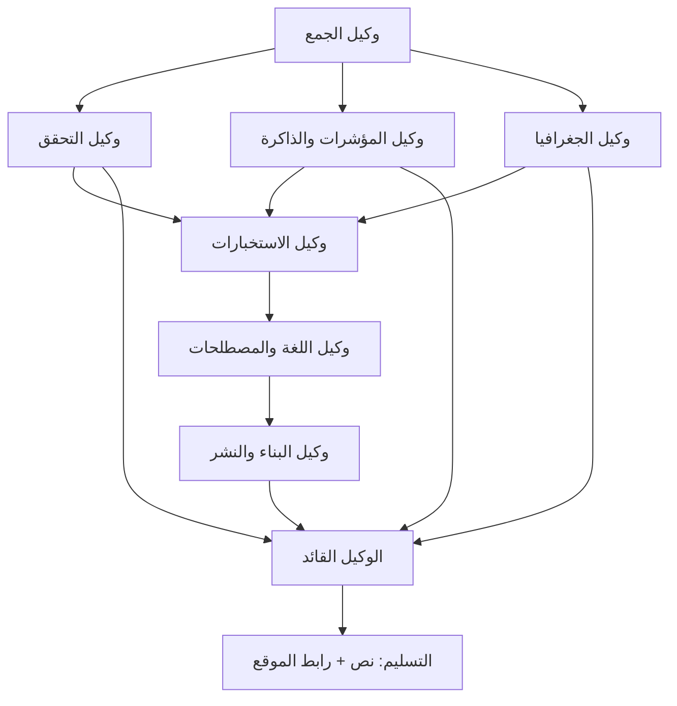

# مناقشة: توزيع التقرير الصباحي على وكلاء متخصصين (بدون تنفيذ)

**التاريخ:** 14 أكتوبر 2026 · **النوع:** مناقشة تصميم — لا يُنفَّذ منها شيء إلا بقرار صريح

---

## 1) الفكرة كما فهمتها

بدلًا من وكيل واحد ينجز التقرير الصباحي من أوله إلى آخره:

1. يُخصَّص **وكيل مستقل لكل مهمة** داخل التقرير (جمع · تحقق · مؤشرات · خريطة · تحليل استخباري · تدقيق لغوي · بناء ونشر…).
2. الوكلاء **يتواصلون فيما بينهم** ويسلّم كل واحد ناتجه لمن يحتاجه.
3. في القمة **وكيل مسؤول** تصل إليه كل المخرجات، وهو الذي يسلّمك التقرير الصباحي.

هذا النمط معروف في هندسة الوكلاء باسم **التنسيق الهرمي مع عقد تسليم موحّد**، وليس فكرة نظرية: نحن نستخدمه فعلًا في جزء من نظامنا، وسأبين أين.

---

## 2) الحكم المختصر

- **صحيح تمامًا** في المراحل التي تحتاج **حكمًا متعدد الزوايا أو جمعًا متوازيًا**: مسح المصادر الأربعين، التحقق المستقل، التحليل الاستخباري، التدقيق اللغوي.
- **خطأ مكلف** إذا صار **كل شيء** وكيلًا: الأجزاء الحتمية (فحص العقوبات · بصمة الأصول · ترقيم النسخة · دمج الدفتر · البوابات) يجب أن تبقى **كودًا** لا وكلاء، لأن الكود يعطي النتيجة نفسها كل مرة، بينما الوكيل يستهلك وقتًا ورصيدًا ويمكن أن يجتهد ويخطئ.
- **مبدأ لا يُخترق:** **وكيل واحد فقط يكتب النص العربي النهائي الموجّه للقارئ**، وبقية الوكلاء يسلّمون **بيانات منظّمة** لا نصوصًا أدبية. السبب مباشر: أسلوبك المعتمد (عربية بسيطة + مصطلحات عسكرية بحرية) وملاحظة مديرك على اللغة تُفقد فورًا إذا كتب ستة وكلاء نصوصًا مختلفة النبرة.

---

## 3) ما هو موجود عندنا فعلًا (لا نبدأ من الصفر)

| العنصر الحالي | ماذا يعادل في فكرتك |
|---|---|
| مسح المصادر الأربعين بوكلاء متوازيين (40 مهمة فرعية) | وكيل لكل مصدر + وكيل تجميع — مُجرَّب وناجح |
| وكيلان للمراجعة (تصميم الصفحة + نظم المعلومات) | وكلاء مراجعة متخصصون |
| المولّد والبوابات والمدققون | «وكلاء» حتميون بالكود — أدق وأرخص من أي وكيل ذكي |
| وكيل رئيسي واحد يكتب التقرير ويسلّمه داخل المحادثة | الوكيل القائد في فكرتك (موجود فعلًا) |

أي أن نصف المعمارية مطبَّق، والناقص هو **تخصيص وكلاء للحكم** في أربع مراحل: التحقق، المؤشرات والذاكرة، التحليل الاستخباري، التدقيق اللغوي.

---

## 4) المعمارية المقترحة

### 4.1 الأدوار (ثمانية)

| # | الوكيل | مسؤوليته الوحيدة | ناتجه |
|---:|---|---|---|
| 1 | **الجمع** | تشغيل الخط اليومي، التغذيات، حفظ الأصول الرسمية | `feeds.json` + `archive/manifest.json` |
| 2 | **التحقق** | فحص المصادر الأربعين، درجات الموثوقية A–F / 1–6، منع ترقية المصداقية بلا تأكيد مستقل | `sources[]` بدرجاتها وأساس كل درجة |
| 3 | **المؤشرات والذاكرة** | الأرقام والفروقات ونوافذ 24/48/72 ساعة، دمج الدفتر، حل الرموز | `indicators[]` + `event_codes[]` |
| 4 | **الجغرافيا** | الإحداثيات ونقاط الخريطة والتوزيع بلا دمج منطقتين في رقم واحد | `geo[]` |
| 5 | **الاستخبارات** | ACH، درجة الثقة منفصلة عن الاحتمال، الافتراضات ومؤشرات التحذير المبكر | `intel{}` |
| 6 | **اللغة والمصطلحات** | بوابة العسكرية والبساطة، منع العبارات الداخلية والأكاديمية | تقرير تصحيحات مقترحة |
| 7 | **البناء والنشر** | توليد الصفحة، الفحص الآلي، النسخة الاحتياطية، النشر | صفحة + نقطة استعادة |
| 8 | **القائد** | حلّ التعارض، منح الرموز، كتابة النص النهائي، تشغيل البوابات، التسليم لك | التقرير الصباحي |

### 4.2 تدفّق العمل



### 4.3 عقد التسليم الموحّد (الحزمة)

كل وكيل لا يسلّم نصًا، بل **حزمة واحدة بالشكل نفسه** حتى يستطيع القائد دمجها بلا ترجمة:

```json
{
  "agent": "verification",
  "date": "2026-10-14",
  "items": [
    {"key": "UKMTO-171", "value": "بلاغ هجوم — هرمز",
     "source": "UKMTO", "grade": "A2", "confidence": "high",
     "evidence": "archive/originals/2026-10-14/ukmto-171.html"}
  ],
  "warnings": [],
  "needs_decision": ["تعارض بين مصدرين على موقع الواقعة"]
}
```

**قاعدتان في العقد:**
1. **لا رقم بلا مصدر ودرجة** — أي رقم في التقرير يجب أن يوجد في حزمة أحد الوكلاء مع مصدره.
2. **لا نص موجّه للقارئ** — الصياغة النهائية للقائد وحده، فيبقى للتقرير صوت واحد.

---

## 5) المكاسب المتوقعة — مربوطة بأخطاء وقعت فعلًا

| الخطأ الذي وقع عندنا سابقًا | هل يعالجه توزيع الوكلاء؟ |
|---|---|
| تناقض الأرقام بين الأ
| تناقض رقم بين قسمين في الإصدار نفسه | **نعم، جذريًا** — لأن كل رقم يُنتَج في وكيل واحد ويُستهلك كما هو |
| ترقية مصداقية مصدر بلا تأكيد مستقل | **نعم** — وكيل التحقق مستقل عن وكيل الجمع، فلا يجامل ناتجه |
| تسرّب عبارة داخلية أو شيفرة إلى النص | **نعم** — وكيل اللغة بوابة مستقلة على المخرَج النهائي |
| رمز حدث غير محلول في خريطة الرموز | **نعم** — وكيل المؤشرات يمنع التسليم بلا حلّ الرموز |
| سفينة بلا نتيجة فحص عقوبات | **لا** — هذا كود حتمي، والوكيل لا يضيف قيمة |
| فشل صامت في خطوة تشغيل (مثل `rsync` غير المثبّت) | **لا** — يُعالج بفحص ما قبل التشغيل لا بوكيل |
| ثقل اللغة أو مصطلح غير عسكري | **نعم، بشرط** — أن يكون وكيل اللغة مسلّحًا بقاموسنا المعتمد لا بذوقه العام |

الخلاصة: توزيع الوكلاء يعالج **أخطاء الحكم والاتساق**، ولا يعالج **أخطاء الأدوات**. وهذا يحدد بدقة أين نضعه.

---

## 6) الكلفة والمخاطر

| المخاطرة | الوصف | الضابط المقترح |
|---|---|---|
| كلفة الرصيد | 8 وكلاء يوميًا = 8 أضعاف عمل الحكم، وأعلى من تشغيل واحد | لا يصير وكيلًا إلا ما يحتاج حكمًا؛ والأدوات الحتمية تبقى كودًا |
| زمن التسليم | التتابع يبطئ؛ التوازي يسرّع | تشغيل ما لا يعتمد على غيره بالتوازي (جمع · جغرافيا · مؤشرات) |
| تشتّت الصوت | ست نبرات في تقرير واحد | النص النهائي للقائد وحده |
| تناقض داخلي | وكيلان يحسبان الرقم نفسه بطريقتين | «مالك واحد لكل رقم» + عقد الحزمة |
| الفشل الجزئي | وكيل يسقط فيتوقف التقرير | لكل وكيل مسار بديل: يُذكر الفشل في التقرير ولا يُسقط الإصدار، ما لم يكن فشلًا في بوابة مانعة |
| تعارض لا يُحسم | وكيلان يعطيان استنتاجين متضادين | القائد يفصل بقاعدة معلنة، ويسجّل الفصل في سجل التعلم |
| إرهاق الإشراف | كل وكيل يحتاج تعليمات وصيانة | ملف تعليمات مختصر لكل وكيل داخل `sections/` + بوابة قبول |
| «دوامة الوكلاء» | وكيل يستهلك وقتًا في البحث بلا سقف | مهلة وحدّ مخرجات لكل وكيل، وإلزامه بالحزمة لا بالسرد |

---

## 7) ما يجب ألّا يصير وكيلًا

1. فحص العقوبات ومطابقة الأسماء.
2. بصمة الأصول الرسمية وحفظها.
3. ترقيم النسخة وتصفير المتسلسل شهريًا.
4. دمج الدفتر التراكمي وحل الرموز.
5. البوابات المانعة (البنية · اللغة الآلية · التحليل الاستخباري).
6. بناء الصفحة والنشر.

هذه كلها **كود حتمي**: نتيجتها واحدة كل مرة، وكلفتها شبه صفر، ولا تحتاج اجتهادًا. تحويلها إلى وكلاء يجعلها أغلى وأقل ثباتًا.

---

## 8) خطة تجريبية على أربع مراحل (مقترحة، لا منفَّذة)

| المرحلة | المحتوى | معيار النجاح |
|---|---|---|
| 1 | وكيل تحقق + وكيل مؤشرات، وناتجهما حزمة واحدة يستهلكها القائد | صفر تناقض رقمي في ثلاثة إصدارات متتالية |
| 2 | وكيل استخباري مستقل عن كاتب القسم | كل تقدير له درجة ثقة ومصدر A–F/1–6، ويفشل الإصدار عند غيابها |
| 3 | وكيل لغة مستقل قبل التسليم | صفر ملاحظة لغوية أو مصطلح غير عسكري في المراجعة الأسبوعية |
| 4 | وكيل بناء ونشر منفصل (تشغيل آلي) | التسليم ينجح بلا تدخل يدوي ثلاث مرات متتالية |

**قياس العائد:** يُقارن معدل الملاحظات في سجل التعلم قبل التوزيع وبعده لكل إصدار. إن لم ينخفض عدد الأخطاء، أو ارتفع الزمن والكلفة بلا مقابل، نعود إلى النموذج الأبسط. لا نتبنى المعمارية بالإعجاب، بل بالقياس.

---

## 9) توصيتي النهائية

**نموذج هجين على ثلاث طبقات:**

1. **الطبقة الحتمية (كود):** الخط اليومي والبوابات والمولّد والنشر — تبقى كما هي، وهي العمود الفقري.
2. **طبقة الحكم (وكلاء متخصصون):** نبدأ بوكيلين لا ثمانية — **التحقق** و**المؤشرات والذاكرة** — لأنهما مصدر أكثر أخطائنا المسجّلة، ثم نضيف الاستخبارات واللغة بعد قياس المرحلة الأولى.
3. **طبقة القيادة (وكيل واحد):** أنا، أكتب النص النهائي وأحلّ التعارض وأسلّمك — فيبقى التقرير بصوت واحد، وتبقى مسؤولية التسليم في نقطة واحدة واضحة.

بهذا تحصل على مزايا فكرتك (تخصص · استقلال تحقق · توازي · فصل المسؤوليات) بلا ثمنها الكامل (تشتّت الأسلوب · الكلفة · هشاشة التنسيق).

---

## 10) أسئلة تحتاج قرارك

1. **النطاق:** أبدأ بوكيلين (تحقق ومؤشرات) أم تريد الثمانية كاملة من أول تشغيل؟
2. **الكلفة:** هل تقبل ارتفاع كلفة التشغيل اليومي مقابل انخفاض الأخطاء، أم نحدّد سقفًا للكلفة أولًا؟
3. **صوت التقرير:** هل تقبل أن يبقى النص النهائي بيد القائد وحده، أم تريد أن يكتب كل وكيل قسمه بصياغته؟
4. **حالة الخلاف:** عند تعارض وكيلين، هل تريد أن يظهر الخلاف في التقرير («مصدران يختلفان على…») أم يُحسم داخليًا بلا ذكر؟
5. **القياس:** ما معيار النجاح الذي تقبله للحكم على التجربة — صفر تناقض رقمي، أم صفر ملاحظة لغوية، أم كليهما لثلاثة إصدارات متتالية؟
