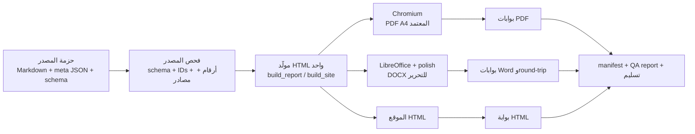

# مواصفة التدقيق الهندسي لسلسلة التقرير العربي اليومي

_تقييم ثابت للملفات الموجودة في 18 أكتوبر 2026؛ لا يتضمن تشغيل متصفح أو إعادة تصدير أصول._

---

## ✅ الحكم التنفيذي

**التوصية الواحدة:** اعتماد **HTML دلالي + Chromium/Playwright كمسار الطباعة المعتمد**، مع إبقاء Word/DOCX **نسخة تحرير مشتقة** وليست مصدر الحقيقة ولا مرجع الطباعة. مصدر الحقيقة هو حزمة الإصدار النصية المهيكلة: Markdown للمحتوى وJSON للبيانات، مع معرّفات ثابتة وبصمات تحفظ العلاقة بين الفقرات والأقسام في كل مخرج.

هذا الاختيار يطابق الحالة الحالية أكثر من أي بديل: الموقع وPDF يخرجان من مولّد واحد، وRTL وتشكيل العربية يعتمدان على محرك متصفح ناضج، والأتمتة اليومية منخفضة الكلفة، وCSS الطباعة موجود ومقاسه ببوابة فعلية. الثمن هو أن ضبط فواصل الصفحات ليس حتميًا تلقائيًا، وأن DOCX لن يكون مطابقًا بكسليًا للـPDF بعد تحويله عبر LibreOffice.

> **قاعدة قبول مهمة:** PDF هو نسخة الاعتماد والطباعة. Word يضمن تطابق المحتوى والبنية والمراجع المخفية، لكنه لا يضمن تطابق التفاف السطور أو مواضع فواصل الصفحات بعد تحرير يدوي.

### ما ظهر من القراءة الساكنة

- `build_report.py` يصرّح صراحة بأن الحقيقة هي Markdown + `meta`، ويحوّل العناوين `##` إلى أقسام HTML، ويطبق `dir="rtl"` و`bdi`/`unicode-bidi:isolate` للأرقام والرموز.
- `build_site.py` يعيد استخدام المولّد نفسه للموقع، لكنه يتوقع `sources/reports/<date>-sectioned.md` و`sources/meta/<date>.json`، بينما أدوات أخرى تقرأ `reports/<date>-sectioned.md`. يجب توحيد هذا المسار قبل اعتباره خطًا إنتاجيًا واحدًا.
- `export_report_assets.py` يثبت Playwright على A4، `print_background=True`، هوامش `16/18/18 mm`، ترويسة وتذييل، وفهرسًا بتمريرتين، ثم يستدعي `check_pdf_format.py`.
- `build_report_docx_exact.py` يحوّل HTML إلى DOCX عبر LibreOffice، ثم يفرض RTL وهوامش A4 وتذييل الصفحات؛ لكنه يغير الخط إلى Arial ولا ينسخ ترويسة PDF كاملة، كما أن فحصه النهائي يطبع المخالفات ولا يعيد رمز فشل عند عدم التطابق.
- تقرير `notes/print-fix-2026-10-18.md` يثبت أن سبب الفراغات كان حاويات `grid/flex` و`overflow:hidden` وعناصر غير قابلة للتقسيم، وأن الإصلاح رفع متوسط التعبئة من 90.1% إلى 95.7% وخفّض الصفحات من 19 إلى 15.
- توجد **مفارقة مانعة**: `check_pdf_format.py` يقرأ نطاق صفحات افتراضيًا `[17, 22]` من `print-profile.json`، بينما تقرير الإصلاح يقول إن النتيجة المعتمدة بعد الإصلاح هي 15 صفحة. إن لم يكن الملف الشخصي قد عُدّل، فالبوابة سترفض الإصدار الصحيح أو ستجعل الاعتماد غير قابلًا للتنبؤ.
- `build_site.py` يتجاوز أزواج المصادر الناقصة ويسجل تحذيرًا، ويمرر البناء؛ هذا مناسب لموقع أرشيفي، لكنه غير مناسب لإصدار اليوم: الإصدار الحالي يجب أن يفشل مغلقًا إذا غاب ملفه أو فشل بناؤه.

## 🧭 مقارنة محركات الإخراج وحسم القرار

| المعيار | HTML + Chromium | XeLaTeX/LaTeX | Typst | قالب Word/DOCX | InDesign/IDML |
|---|---|---|---|---|---|
| دقة الفواصل والتعبئة | جيدة بعد CSS وقياس raster؛ حساسة للحاويات الطويلة وتغيّر الخط | ممتازة وقابلة للضبط الحتمي نسبيًا | ممتازة في التنضيد، لكن تحتاج اختبارًا فعليًا لـRTL والقوالب الحالية | متوسطة؛ Word وLibreOffice قد يختلفان | ممتازة بصريًا |
| RTL وتشكيل العربية | قوي عمليًا مع `dir=rtl` والخطوط المناسبة والعزل | قوي، لكن إعداد bidi/polyglossia والخطوط يحتاج صيانة | واعد، ويجب اعتماد نتيجة عملية قبل التزام إنتاجي | دعم RTL موجود لكن الجداول والحقول والنسخ بين المحركات حساسة | قوي جدًا في الإخراج الاحترافي |
| الترقيم والفهرس | يحتاج تمريرتين وحارسًا؛ الموجود يطبق ذلك | أصلي وناضج | أصلي وناضج | أصلي، لكن الأرقام قد تتغير عند فتح الملف بمحرك آخر | قوي، لكنه جزء من ملف تصميم لا من نموذج بيانات بسيط |
| أتمتة يومية | ممتازة؛ Python + Playwright + أدوات النظام | جيدة، مع سلسلة حزم وخطوط ووقت بناء أعلى | جيدة، مع ضرورة تثبيت الإصدار | متوسطة؛ LibreOffice headless يحتاج عزل ملف تعريف وفحصًا | ضعيفة إلى متوسطة؛ ترخيص وبيئة تشغيل وتكامل IDML |
| الموقع من نفس المصدر | مباشر؛ نفس HTML يذهب للويب وPDF | يحتاج مولّد ويب ثانٍ واحتمال اختلاف المحتوى | يحتاج مسار ويب ثانٍ | يحتاج مسار HTML ثانٍ | يحتاج مسار ويب ثانٍ |
| التحرير اليدوي لصاحب القرار | ضعيف في HTML/PDF | ضعيف | ضعيف | الأفضل | ممتاز |
| الكلفة التشغيلية | منخفضة بعد تثبيت Chromium والخطوط | متوسطة؛ حزم وخطوط وصيانة | منخفضة إلى متوسطة | منخفضة، لكن ثمنها في الانحرافات | عالية |
| الحكم لهذه الحالة | **المعتمد** | بديل قوي لو كان PDF فقط | بديل مستقبلي لا يبرر إعادة البناء الآن | مشتق للتحرير فقط | غير مبرر لسلسلة يومية آلية |

### لماذا HTML+Chromium هو الاختيار الصحيح هنا؟

1. **يحقق المخرجين الأساسيين من منبع واحد:** الموقع وPDF هما إسقاطان من نفس DOM وCSS، فلا نعيد كتابة التقرير لمحرك ثانٍ.
2. **يخدم العربية والأرقام المختلطة فعليًا:** `lang="ar"`, `dir="rtl"`, `bdi`, والعزل الاتجاهي موجودة في المولّد وليست سياسة نظرية.
3. **يتناسب مع التقرير المتغير يوميًا:** جداول، بطاقات، خريطة SVG، روابط، حالة مصادر، وبنية أقسام يمكن توليدها من Python دون تدخل تصميم يدوي.
4. **قابل للقياس:** `pdftoppm` و`pdftotext` وبوابة الفجوات تعطيان مؤشرات قابلة للرفض، وهو ما أثبتت فائدته في إصلاح 18 أكتوبر.
5. **تكلفته ومخاطره أقل من إعادة بناء نظام كامل في LaTeX/Typst/InDesign.**

### ضعف البدائل ومتى يصبح أحدها أفضل

- **XeLaTeX:** أفضل اختيار إذا أصبح المطلوب PDF كتابيًا فقط، بأحكام تنضيد صارمة جدًا، ومن دون موقع تفاعلي أو نسخة Word يومية. سيحتاج مسار HTML منفصلًا، وبذلك يفقد مبدأ التطابق بين الموقع وPDF.
- **Typst:** خيار واعد لتقليل تعقيد LaTeX، لكنه لا يبرر الآن نقل خريطة وكتل HTML وسياسة الإخفاء والفهرس الحالية قبل اختبار RTL والخطوط والنسخ الفعلية. لا يُعتمد بلا مجموعة عينات عربية طويلة ومقارنة PDF.
- **قالب DOCX:** أفضل عندما تكون النسخة التي يحررها صاحب القرار هي المنتج الرئيسي. لكنه يجعل PDF تابعًا لمحرك Word/LibreOffice، ويخلق اختلافات في الالتفاف والترقيم، كما لا يولد الموقع من دون قالب ثانٍ.
- **InDesign/IDML:** مناسب لمجلة مصممة يدويًا أو إخراج نشر فاخر قليل التغير، وليس لخط يومي يتغير فيه طول قسم وخريطة ومصادر ويجب تشغيله دون مصمم.

## 🏗️ مصدر الحقيقة والمعمارية المقترحة

لا يُسمح أن يكون HTML أو PDF أو DOCX مصدرًا لاحقًا للنسخ الأخرى. المصدر هو **حزمة التقرير اليومية**، وهي منطقيًا مصدر واحد حتى إن كانت محفوظة في ملفين بسبب اختلاف طبيعة المحتوى:

```text
sources/
  reports/YYYY-MM-DD-sectioned.md   # النص، ترتيب الأقسام، الجداول، الاستشهادات
  meta/YYYY-MM-DD.json              # الهوية، المؤشرات، الخريطة، القرار، التايملاين، التصنيف
schemas/report-meta-2.1.json        # عقد JSON المعلن
manifests/YYYY-MM-DD.json           # يُولد آليًا: hashes + IDs + tool versions + policy

generated/YYYY-MM-DD/
  report.html
  report.pdf
  report.docx
  docx-roundtrip.pdf
  qa.json
```

الحد الأدنى المطلوب في المصدر:

- هوية إصدار صريحة: `date`, `version`, `classification`, `generated_label`، وبصمة المحتوى.
- معرف ثابت لكل قسم وفقرة/عنصر مهم، مثل `sec-03`, `p-sec-03-004`, `event-MN-...`. إذا تعذر وضع المعرف في Markdown، يُحفظ جدول `content_ids` في `meta.json` أو تعليقات HTML غير معروضة.
- التحقق من أن كل رمز حدث في النص موجود في `event_keys`، وكل نقطة خريطة لها رمز وبيانات صحيحة.
- التمييز بين **محتوى يجب أن يظهر في PDF** و**محتوى محجوب في PDF**، بدل الاعتماد على مطابقة نص عنوان فقط.
- رقم نسخة الأدوات والسياسات: Python، Playwright/Chromium، الخطوط، `print-profile.json`، وبصمة CSS الطباعة.



### تغييرات اتساق لازمة قبل الاعتماد

1. اختيار جذر واحد للمصادر؛ الأفضل جعل `sources/reports` و`sources/meta` هو المسار الوحيد، وتعديل `validate_report.py` و`check_pdf_format.py` و`build_report_docx_exact.py` ليقرؤوا منه.
2. عدم السماح لـ`build_site.py` بتجاوز فشل إصدار اليوم؛ يمكن إبقاء التجاوز للأرشيف مع فشل صريح عند `--date` الحالي.
3. جعل فشل الخريطة أو الفهرس فشلًا مانعًا إذا كانا جزءًا من قالب الاعتماد، بدل طباعة تحذير والاستمرار.
4. توحيد `print-profile.json` مع نتيجة الإصلاح: لا تثبيت عدد صفحات ضيق؛ يفضل قبول ميزانية تعبئة/فجوات وصفحات قصوى، أو تحديث النطاق إلى سياسة جديدة موثقة.
5. تثبيت الخطوط محليًا داخل بيئة البناء وعدم الاعتماد على Google Fonts الشبكية أثناء الإصدار؛ يجب انتظار `document.fonts.ready` وتسجيل الخط الفعلي.

## 📝 مطابقة Word للـPDF وحدودها

### الخيارات

| الخيار | ما يضمنه | ما لا يضمنه | متى يُختار |
|---|---|---|---|
| HTML الطباعة ← LibreOffice ← DOCX | أعلى إعادة استخدام، النص والأقسام من HTML نفسه، وقت إعداد قليل | اختلاف CSS، الخطوط، فواصل الصفحات، الجداول، الترويسة، والخريطة؛ Word ليس نسخة بكسل من PDF | **الخيار الحالي** إذا كان Word نسخة مراجعة/تحرير |
| قالب DOCX + `python-docx` | أنماط Word مستقرة، تحرير يدوي ممتاز، رؤوس وتذييلات وجداول يمكن التحكم بها | يحتاج مولدًا ثانيًا؛ لا يضمن أن PDF الناتج يساوي PDF Chromium | إذا صار Word هو مستند العمل الرئيسي أو يلزم تحرير كثيف |
| PDF ← DOCX | أسرع حل لملف خارجي بلا مصدر HTML | ترتيب RTL، الجداول، الحواشي، النصوص العربية، والمعرفات قد تتشوه؛ أسوأ خيار للحفاظ على المصدر | طوارئ أو استيراد تاريخي فقط، لا للإنتاج اليومي |

### المسار المعتمد عمليًا

1. ابنِ HTML من المصدر، ثم PDF المعتمد من **نفس HTML**.
2. أنشئ DOCX من نسخة الطباعة نفسها كما يفعل `build_report_docx_exact.py`، مع تثبيت الخطوط والهوامش، واستبدال SVG المعقد بصورة معتمدة عند الحاجة.
3. أضف لكل فقرة/قسم مخفيًا أو في `meta` معرفًا ثابتًا، ثم احتفظ بجدول `source_id → html_id → docx paragraph/table` أثناء التوليد إن أمكن.
4. حوّل DOCX الناتج إلى `roundtrip.pdf` عبر LibreOffice، واستخرج نصه بـ`pdftotext`. افحص **اكتمال النص، ترتيب الأقسام، غياب المصادر المحجوبة، الأرقام والرموز**.
5. افحص الصفحة بصريًا على مستوى الميزانية، لا على أساس مساواة البكسلات: عدد الصفحات، امتلاء الصفحات، مواضع العناوين، عدم قص النص، والخريطة.
6. إذا حرر صاحب القرار DOCX، تُعاد التغييرات إلى Markdown/JSON يدويًا أو بأداة مراجعة؛ لا يُعاد استعمال DOCX المحرر كمصدر للإصدار التالي.

**حد المطابقة:** يمكن جعل المحتوى والبنية متطابقين تقريبًا أو كليًا قبل التحرير، لكن لا يمكن ضمان تطابق التفاف السطر وفاصل الصفحة بين Chromium وLibreOffice/Word لأن محركات القياس والخطوط وتطبيق CSS مختلفة. لذلك يجب أن تكون المطابقة المطلوبة في عقد التسليم: `text coverage = 100%` للأجزاء المطلوبة، `hidden coverage = 0%` للمحجوب، وميزانية هندسية معلنة للفروق البصرية.

## 🧪 خط فحص آلي يومي من عشر بوابات

يقترح إنشاء مشغّل واحد: `python3 tools/run_daily_qa.py --date YYYY-MM-DD`. كل بوابة مستقلة، لا تعتمد على حكم النموذج، وتعيد: **0 اجتياز، 1 مخالفة مانعة، 2 مدخل/أصل ناقص أو غير صالح**. يمكن للمشغّل تحويل الرموز القديمة (`check_pdf_format=4`، `validate_report=2/3`) إلى هذا العقد الموحد. لا يُسلّم الإصدار إذا أعادت أي بوابة 1 أو 2.

| # | البوابة | ما تحكمه برمجيًا | دليل/أداة | الخروج |
|---:|---|---|---|---:|
| 1 | حزمة المصدر والمخطط | وجود زوج MD+JSON لنفس التاريخ، JSON صالح، `report_schema_version`، الحقول الإلزامية، وعدم وجود ملفات مؤقتة | `validate_report.py` + `jsonschema`/مدقق Python | 0/1/2 |
| 2 | الهوية والمعرفات | تاريخ واحد، نسخة واحدة، تصنيف معتمد، عناوين/IDs غير مكررة، كل event code في سجل واحد وثابت | Python يقرأ المصدر و`meta.json` | 0/1/2 |
| 3 | سلامة المدخلات الرقمية والمصادر | أنواع الأرقام والإحداثيات والاحتمالات، مجموع الاحتمالات 100%، كل رابط مصدر مصنف، وعدم وجود مصدر مطلوب بلا حالة | قواعد `validate_report.py` الموسعة | 0/1/2 |
| 4 | بناء HTML مغلق | لا استثناءات، كل الأقسام موجودة، الخريطة وبطاقة القرار والعناوين موجودة، `lang=ar` و`dir=rtl`، ولا أخطاء/وسوم هاربة | `build_report.py` ثم فحص DOM/HTML ثابت بلا متصفح | 0/1/2 |
| 5 | تطابق المصدر مع HTML | كل عنوان وفقرة وجدول مطلوب من المصدر موجود في HTML بعد تطبيع Unicode والمسافات؛ لا نص زائد من إصدار سابق | Python + BeautifulSoup/regex ومعرفات ثابتة | 0/1/2 |
| 6 | اكتمال PDF وسياسة الحجب | `pdftotext` يجد كل الأقسام غير المحجوبة ومحتواها؛ لا يجد «المصادر والمراجع» أو «موثوقية المصادر» ولا أي علامة حجب؛ لا صفحة فارغة | `pdftotext` + `check_pdf_format.py` | 0/1/2 |
| 7 | هندسة الصفحات | A4، الهوامش، عدد الصفحات ضمن سياسة الإصدار، متوسط التعبئة، الحد الأدنى لكل صفحة، والفجوات الداخلية؛ النص لا يلامس حافة القص | `pdfinfo` + `pdftoppm` + قياس `page_metrics` | 0/1/2 |
| 8 | الفهرس والترقيم وRTL | كل بند فهرس له رقم صفحة حقيقي، والعنوان يظهر أولًا في الصفحة المعلنة، الأرقام متسلسلة، التذييل حاضر في كل صفحة، ولا انقلاب واضح للرموز | `pdftotext -layout` + خريطة صفحات + فحص محارف الاتجاه | 0/1/2 |
| 9 | Word round-trip | DOCX قابل للفتح والتحويل، كل النص المطلوب حاضر في `roundtrip.pdf`، الأقسام بالترتيب، الحجب مطابق، الأرقام والرموز متساوية؛ فرق الصفحات/التعبئة داخل الميزانية | `soffice` + `pdftotext` + `pdfinfo` + `pdftoppm` | 0/1/2 |
| 10 | الحزمة والتسليم | أسماء الملفات والتاريخ والبصمات متطابقة، لا روابط مؤقتة أو تصنيف حساس في الموقع العام، `qa.json` وmanifest محفوظان، ووقت البناء ضمن نافذة الإصدار | Python + `sha256sum` + فحص مسارات | 0/1/2 |

### حدود رقمية مقترحة للبوابة

- متوسط تعبئة PDF: **≥ 92%**، ولا صفحة محتوى أقل من **70%** إلا الغلاف/الأخيرة إذا سمحت السياسة.
- فجوة داخلية: **< 45 mm**، مع تسجيل الصفحة والموضع؛ لا تُخفى المشكلة بتوسيع النطاق.
- فهرس: 100% من البنود لها صفحة، و100% من العناوين المعلنة تطابق الصفحة الأولى لظهورها.
- المحتوى: كل عنوان/فقرة/خلية رقمية ذات ID مطلوبة موجودة في HTML وPDF وDOCX round-trip؛ العناصر المحجوبة صفر ظهور في PDF ونسخة Word.
- Word: فرق الصفحات ليس معيار رفض وحده؛ يصبح رفضًا إذا صاحبه فقد نص، قص، ترتيب خاطئ، أو تجاوز ميزانية تعبئة معلنة.

## 🛡️ مقاومة الفشل عند تغيّر بيانات الإصدار

أطول قسم هو نقطة الانكسار المتوقعة، لا الاستثناء. يجب أن تتصرف السلسلة كالتالي:

1. **قبل البناء:** احسب حجم كل قسم وعدد صفوف الجداول وعدد عناصر الخريطة وقارنها بالإصدار السابق. إذا زاد قسم أكثر من عتبة إعداد (`section_growth_warn`) فأنشئ تحذيرًا، وإذا تجاوز سقفًا يمنع صفحة غير قابلة للتقسيم فافشل قبل التصدير.
2. **أثناء HTML:** لا تستخدم `height` ثابتًا للمحتوى، ولا تجعل الحاويات الطويلة `grid/flex` أو `overflow:hidden` في الطباعة. احمِ الوحدات الصغيرة فقط (`tr`, بطاقة، عنوان)، واترك الحاوية الكبيرة قابلة للتدفق كما عالج تقرير 18 أكتوبر.
3. **الخريطة والجداول:** صمّم بديلًا قابلًا للانقسام: SVG محدود الارتفاع، مفتاح متعدد الأعمدة، `thead` متكرر، وخطة لتقسيم الجدول بعد صفوف كثيرة. إذا تعذر ذلك، أعد ترتيب كتلة الخريطة لا ضغط الخط عشوائيًا.
4. **بعد PDF الأول:** لا تعتمد الفهرس من التخمين. التقط pass أول، استخرج الصفحات، حدد العناوين، ثم أعد الحقن والتصدير، وبعده أعد فحص الفهرس؛ أي تغيّر بعد الحقن يلغي أرقام الفهرس.
5. **الخطوط والنسخ:** ثبت Chromium وLibreOffice والخطوط في صورة تشغيل واحدة، وسجل نسخها في manifest. لا تستخدم انتظارًا زمنيًا فقط؛ افحص جاهزية الخطوط ووجود الموارد.
6. **الفشل المغلق:** إذا فشل البناء، الخريطة، PDF، DOCX، أو أي بوابة مانعة، لا تنشر نسخة جزئية ولا تستبدلها بصمت بنسخة الأمس. اترك آخر إصدار منشور سليمًا، وسجل سبب الفشل ومسار الأصول المؤقتة.
7. **قابلية الرجوع:** احتفظ بحزمة المصدر، hashes، `qa.json`، ونسخ الأدوات لكل إصدار. بذلك يمكن إعادة إنتاج PDF حتى بعد تغيّر البيانات أو CSS.
8. **التحرير البشري:** عند تعديل Word، أنشئ فرقًا مراجعيًا يعيد التغيير إلى المصدر؛ لا تسمح بأن يصبح DOCX المحرر فرعًا غير متعقب من الحقيقة.

## 🔧 إجراءات إصلاح ذات أولوية

### مانعة قبل اعتماد الخط

- توحيد جذر المصادر بين `build_site.py`, `validate_report.py`, `check_pdf_format.py`, و`build_report_docx_exact.py`.
- إصلاح نطاق الصفحات المتعارض مع نتيجة 15 صفحة، أو استبداله بميزانية هندسية لا بعدد ثابت.
- جعل `build_report_docx_exact.py` يعيد رمزًا غير صفري إذا كان round-trip ناقصًا أو ظهرت مصادر محجوبة.
- جعل إصدار التاريخ الحالي fail-closed في `build_site.py`، وعدم اعتبار التحذير نجاحًا.
- منع الاعتماد على الخطوط الشبكية أثناء التصدير وتسجيل بصمة CSS/المحرك.

### تحسينات مهمة بعد ذلك

- إضافة معرفات ثابتة للفقرات والجداول، لا الاكتفاء بمطابقة أول 12 حرفًا من العنوان كما تفعل بعض الفحوص الحالية.
- توحيد تعريف الهوامش بين `@page` في HTML و`margin` في Playwright وDOCX، ثم جعل profile هو المرجع الوحيد.
- نقل قياس الفجوات والنص المقصوص إلى مشغّل QA واحد بدل تكرار قواعد متقاربة في أكثر من سكربت.
- جعل الإخفاء قائمًا على `visibility_policy` في المصدر لا على البحث عن أسماء عناوين فقط.

## 🎯 قرار الاعتماد النهائي

يعتمد الخط عندما تكون **حزمة Markdown+JSON هي الوحيدة المعدّلة يدويًا**، ويُنتج منها HTML الموقع وPDF المعتمد وDOCX التحريري في تشغيل واحد يحمل نفس `release_id` وhash المصدر. لا يُعدّل PDF أو HTML يدويًا. يُسمح بتعديل DOCX لصاحب القرار، لكن أي تعديل يراد حفظه في الإصدار التالي يجب أن يعود إلى المصدر ويعيد تشغيل البوابات العشر.

إذا تغيّر الهدف مستقبلًا إلى «PDF فاخر فقط» مع توقف الموقع وWord كمتطلبات أساسية، يعاد تقييم XeLaTeX أو Typst. أما ضمن المتطلبات الحالية الثلاثة والإصدار اليومي العربي، فإعادة بناء السلسلة على محرك تنضيد ثانٍ أو InDesign ستزيد نقاط التباين أكثر مما ستحل من مشكلة الفواصل.
